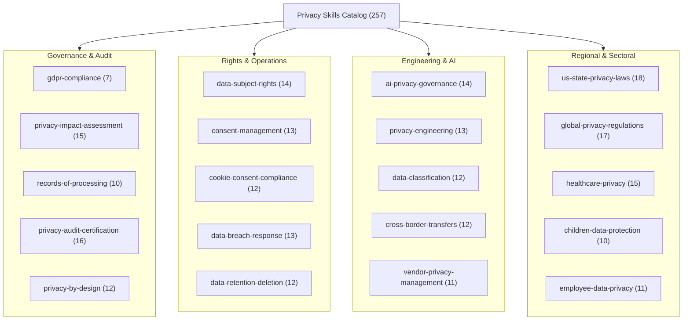

<p align="center">
  <h1 align="center">Privacy & Data Protection Skills for AI Agents</h1>
  <p align="center">
    <strong>257 structured, machine-readable privacy engineering and compliance procedures for AI coding agents.</strong>
  </p>
</p>

<p align="center">
  <a href="https://opensource.org/licenses/Apache-2.0"></a>
  <a href="https://bun.sh"></a>
  <a href="https://skills.sh"></a>
  <a href="https://github.com/imMamdouhaboammar/privacy-skills"></a>
  <a href="https://github.com/imMamdouhaboammar/bug-killer"></a>
  <a href="https://github.com/imMamdouhaboammar/privacy-skills/actions"></a>
  <a href="https://github.com/imMamdouhaboammar/privacy-skills/pulls"></a>
</p>

---

## Overview

**Privacy Skills** is an authoritative, open-source library of **257 curated, verified privacy engineering and statutory compliance procedures** designed for modern AI coding agents (Claude Code, Google Antigravity, Gemini CLI, Cursor, OpenAI Codex).

AI agents frequently encounter privacy-sensitive codebases (PII ingestion, telemetry, user data exports, ML model training, cross-border infrastructure), but default LLM statistical memory suffers from hallucinated articles, out-of-date breach notification clocks, and ad-hoc compliance checklists. 

This repository replaces hallucination with precision by packaging:
- **Statutory Authority**: Concrete articles from GDPR (EU 2016/679), EU AI Act (EU 2024/1689), CCPA/CPRA, HIPAA (45 CFR), LGPD, PIPL, and India DPDP Act.
- **Engineering Standards**: OWASP Top 10 Privacy Risks v2.0 (P1–P10), NIST Privacy Framework v1.0, ISO/IEC 27701:2025 (PIMS), and LINDDUN privacy threat modeling.
- **Deterministic Python Engines**: 100% of the 257 skills include an executable `scripts/process.py` runner with offline simulation fallbacks and zero mandatory external services.

---

## Architecture & Subdomain Families

All 257 skills are organized into twenty specialized subdomains across four operational pillars:



---

## ⚡ Dynamic Intent Router

Query the catalog by keyword, regulation, or framework:

```bash
# 1. Search by keyword
python scripts/router.py "synthetic data differential privacy"

# 2. Filter by statutory framework
python scripts/router.py --regulation GDPR
python scripts/router.py --regulation EU_AI_ACT
python scripts/router.py --regulation HIPAA
python scripts/router.py --regulation CCPA

# 3. Filter by subdomain
python scripts/router.py --subdomain ai-privacy-governance

# 4. Inspect full details of a specific procedure
python scripts/router.py --inspect auto-data-discovery

# 5. Display complete catalog distribution metrics
python scripts/router.py --stats
```

---

## Regulation & Standards Coverage

| Framework / Regulation | Scope & Authority | Procedures | Test Status |
|:---|:---|:---:|:---:|
| **GDPR** | Regulation (EU) 2016/679 (Arts. 5–49) | 202 | Verified 100% |
| **CCPA / CPRA** | California Consumer Privacy Act & 13 US State Laws | 38 | Verified 100% |
| **HIPAA / HITECH** | 45 CFR Parts 160 & 164 (Privacy, Security, Breach) | 32 | Verified 100% |
| **ePrivacy Directive** | 2002/58/EC & EDPB Cookie Guidelines | 24 | Verified 100% |
| **COPPA / AADC** | US Children's Online Privacy & UK Age-Appropriate Design Code | 16 | Verified 100% |
| **EU AI Act** | Regulation (EU) 2024/1689 (High-risk AI, Arts. 9–15, 50) | 14 | Verified 100% |
| **LGPD** | Brazil Lei Geral de Proteção de Dados | 12 | Verified 100% |
| **Cross-Border Transfers** | Standard Contractual Clauses (SCCs), BCRs, EU-US DPF | 12 | Verified 100% |
| **PIPL** | China Personal Information Protection Law | 7 | Verified 100% |
| **DPDP Act 2023** | India Digital Personal Data Protection Act | 7 | Verified 100% |
| **LINDDUN Threat Modeling** | 7-category systematic privacy threat assessment | 7 | Verified 100% |
| **OWASP Privacy Risks** | Full alignment with Top 10 Privacy Risks v2.0 (P1–P10) | 257 | Mapped 100% |
| **NIST Privacy Framework** | Core 5 Functions (Govern, Identify, Protect, Control, Communicate) | 257 | Mapped 100% |
| **ISO/IEC 27701:2025** | Privacy Information Management System (PIMS) controls | 257 | Mapped 100% |

---

## Multi-Agent Installation

### Option 1: Skills.sh Registry (Vercel)
```bash
npx skills add imMamdouhaboammar/privacy-skills
```

### Option 2: Automated Multi-Agent Installer
Clones and links to Claude Code, Antigravity, Gemini CLI, Cursor, and Codex automatically:
```bash
git clone https://github.com/imMamdouhaboammar/privacy-skills.git
cd privacy-skills
./install.sh
```

### Option 3: Google Antigravity & Gemini CLI
Symlink or copy directly into your local agent configuration:
```bash
mkdir -p ~/.gemini/config/skills/
ln -s "$(pwd)" ~/.gemini/config/skills/privacy-skills
```

### Option 4: Claude Code Plugin
```bash
/plugin marketplace add imMamdouhaboammar/privacy-skills
/plugin install privacy-skills
```

---

## Integration with Bug Killer Ecosystem

This repository forms the authoritative privacy knowledge base for **Bug Killer (`bk`)** ([`imMamdouhaboammar/bug-killer`](https://github.com/imMamdouhaboammar/bug-killer)), the autonomous vulnerability discovery & self-healing engine.

In Bug Killer:
- The deep engine (`src/deep/privacy.rs`) integrates this library directly via embedded indices and git submodule bindings under `skills/privacy`.
- Automated security scans detect unredacted PII in LLM API prompts, unencrypted sensitive inputs, and third-party data leaks, recommending exact remediation procedures from this catalog.

---

## 🛡️ Verification & CI Quality Gate

This entire repository is guarded by an automated multi-layer test suite adhering to the Ponytail Ladder & OmniSkill evaluation standards:

```bash
# Run 100% execution and structural test pass across all 257 skills
python scripts/verify-all.py

# Verify router and catalog index integrity
python scripts/router.py --stats
```

---

## License & Attribution

- **License:** Apache License 2.0 ([`LICENSE`](LICENSE))
- **Author:** [Mamdouh Aboammar](https://github.com/imMamdouhaboammar) (Copyright (c) 2026)
- **Upstream Foundation:** Built upon open-source regulatory specifications and privacy engineering frameworks following the [agentskills.io](https://agentskills.io) standard.
