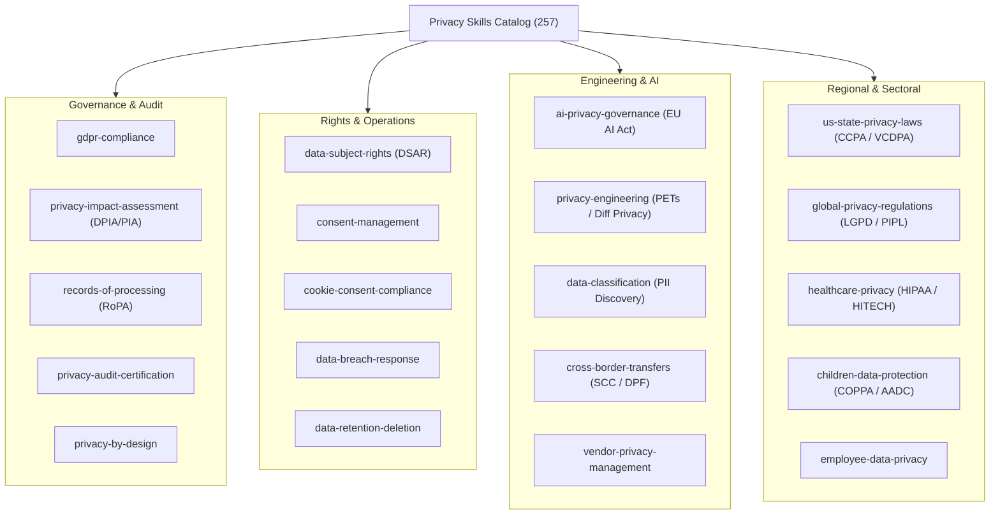

# Privacy & Data Protection Skills Orchestrator

The dynamic privacy execution invariant is:

$$\text{Privacy Requirement} \xrightarrow{\text{Dynamic Router}} \text{Domain Procedure} \xrightarrow{\text{Compliance Artifact}} \text{Evidence Gate} \xrightarrow{\text{Auditor-Ready Decision}}$$

## Overview

Privacy Skills equips AI coding agents (Claude Code, Google Antigravity, Gemini CLI, Cursor, OpenAI Codex) with 257 machine-readable, verified privacy engineering and compliance procedures. Every skill incorporates structured workflows, statutory citations, and an executable automation script (`scripts/process.py`) with zero hallucinated requirements.

Part of the **Bug Killer Security & Autonomous Healing Ecosystem** ([`imMamdouhaboammar/bug-killer`](https://github.com/imMamdouhaboammar/bug-killer)).

---

## ⚡ Dynamic Intent Routing

To automatically find the right procedure for any privacy task:

```bash
# Search by keyword
python scripts/router.py "biometric facial recognition"

# Filter by regulation
python scripts/router.py --regulation GDPR
python scripts/router.py --regulation EU_AI_ACT
python scripts/router.py --regulation HIPAA

# Filter by subdomain
python scripts/router.py --subdomain ai-privacy-governance

# Display full distribution metrics
python scripts/router.py --stats
```

---

## Domain Taxonomy (20 Core Subdomains)



---

## Standard Skill Structure

Every procedure in `skills/<skill-id>/` implements a uniform contract:

- **`SKILL.md`**: Behavioral instructions, legal citations, architecture patterns, and gate conditions.
- **`scripts/process.py`**: Python compliance automation engine, runnable standalone with demo mode.
- **`assets/template.md`**: Auditor-ready markdown template or formal filing artifact.
- **`references/standards.md`**: Exact regulatory articles, recital mappings, and international standards.
- **`references/workflows.md`**: Step-by-step phased execution playbooks.
